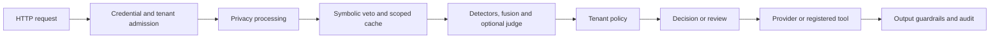

# Gatekeeper

Gatekeeper is a security and governance gateway for AI requests and registered tools. It combines privacy processing, threat detection, tenant policy, human review, output guardrails and audit persistence behind a FastAPI API.

It can assess input before an application calls its own model, proxy requests through configured providers, or authorize a registered tool. HTTP and stdio MCP expose the tool registry. The operator UI is served by the API; Prometheus and Grafana provide operational visibility.

## How it works



The assessment API returns a decision; the integrating application must enforce it. Provider and tool paths enforce their own execution controls. See [architecture](docs/ARCHITECTURE.md) for the actual paths and failure boundaries.

## Security boundaries

- Credentials determine capability and tenant. `AUTH_MODE=required` denies anonymous access. INTERNAL is a trusted administrative tier with explicit cross-tenant access.
- Tenant admission checks suspension and configured-store availability. Rate limits and quotas are process local without Redis and shared when configured; configured Redis failure denies controlled operations.
- Privacy processing redacts personal data; required NER failure denies assessment. Local classifiers can inspect the original prompt.
- Current symbolic vetoes precede HIGH-only cache reuse. Security identity scopes reuse by tenant, input, source, policy, models and runtime.
- Tenant policy returns ALLOW, RESTRICT, BLOCK or REVIEW. HIGH tools require review. Capability/schema checks and one-use bound approval reservation precede execution.
- Output checks block secrets and detected system-prompt leakage, redact PII, and require explicit SAFE toxicity acceptance. Tool intent must persist before effects; later audit failure cannot undo an effect.
- MCP HTTP requires authentication and credential-bound sessions, with bounded ingress/dispatch. Stdio trusts its launcher and fixed process identity.

Detection is probabilistic. Registered Python handlers are trusted code, not a general sandbox. Read the [security contract](docs/SECURITY.md) and [threat model](docs/THREAT_MODEL.md).

## Run locally

Docker Compose starts the API, Redis, Ollama, a judge-model pull job, Prometheus and Grafana. Model downloads require network access, sufficient memory and applicable model access/license approval.

```sh
git clone https://github.com/pavann19/Gatekeeper-AI-Infrastructure-and-Governance-Gateway.git
cd Gatekeeper-AI-Infrastructure-and-Governance-Gateway
cp .env.example .env
python -c "from pathlib import Path; Path('config/api_keys.json').write_text('{}'); Path('config/tenants.json').write_text('{}')"
docker compose up --build
```

Create the empty identity files only in a fresh checkout; do not overwrite provisioned stores. On PowerShell, use `Copy-Item .env.example .env` for the copy. Empty keys permit anonymous GENERAL access under default optional authentication. Provision keys and require authentication before exposing the service. Set a private Grafana password in `.env` and restrict access to published ports. [Deployment](docs/DEPLOYMENT_RUNBOOK.md) covers provisioning, native Python setup, persistent state and models.

| Surface | Local URL |
|---|---|
| API documentation | `http://localhost:8000/docs` |
| Operator UI | `http://localhost:8000/ui/login/index.html` |
| Liveness / readiness | `http://localhost:8000/live` / `http://localhost:8000/ready` |
| Grafana / Prometheus | `http://localhost:3000` / `http://localhost:9090` |

Readiness can return 503 when required models or dependencies are unavailable. `/health` is diagnostic; HTTP 200 there does not establish readiness. See [integration](docs/INTEGRATION_GUIDE.md) for requests and decision handling.

## Test and verify

Use Python 3.10 and a separate source-test environment:

```sh
python -m venv .venv
# Activate .venv before installing; see below.
python -m pip install -r requirements-ci.txt
python -m spacy download en_core_web_sm
python -m scripts.verify --profile unit --output _evidence/unit
```

Activate with `source .venv/bin/activate` on POSIX or `.venv\Scripts\Activate.ps1` on PowerShell. CI dependencies omit downloaded detector models; related cases use mocks or conditional skips. The verifier isolates mutable state and runs lint, types and tests with a coverage floor. Direct commands are:

```sh
python -m ruff check core/ api/
python -m mypy core/ api/ --ignore-missing-imports --explicit-package-bases
python -m pytest tests/ --cov=core --cov=api --cov-fail-under=65
```

The default selection excludes slow replay. Full selection and strict replay require the separate pinned runtime and matching assets in [evaluation](docs/EVALUATION.md). Missing required assets fail the gate. CI also audits dependencies, builds/scans the image, produces an SBOM and tests real Redis backend contracts.

## Evaluation and limitations

No current accuracy, throughput or latency headline is published. Frozen offline replay checks agreement with a decision oracle; it is not an accuracy estimate. Detector-only, cached, live-judge, synthetic and deployment profiles must be reported separately.

Strict replay uses the public hash-pinned frozen corpus and requires separately provisioned pinned model assets and runtime. The historical training suite and synthetic load workload remain local with expected hashes; their reconstruction is not established by the public source. Deployment dependency ranges differ from the canonical runtime. Full application replica acceptance and production operation are unverified.

Request budgets do not bound all synchronous or nested work. Policy reload is per process. Review storage requires a local filesystem with advisory locks. Tool approvals support one-use continuation; prompt/provider review records do not provide an execution continuation endpoint. Gateway system prompts bypass the user-prompt privacy/assessment path and must be trusted application configuration. These are deployment limitations, not a production-readiness claim.

[Architecture](docs/ARCHITECTURE.md) · [Security](docs/SECURITY.md) · [Threat model](docs/THREAT_MODEL.md) · [Evaluation](docs/EVALUATION.md) · [Deployment](docs/DEPLOYMENT_RUNBOOK.md) · [Integration](docs/INTEGRATION_GUIDE.md)
