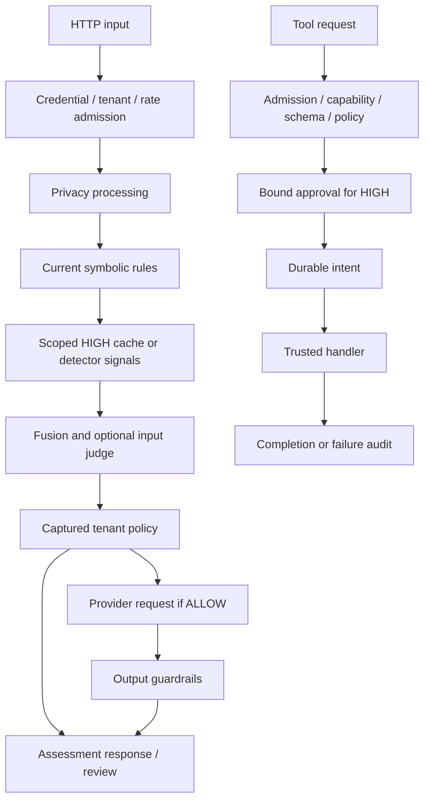

# Architecture

Gatekeeper is a Python modular monolith. FastAPI serves governance endpoints and static operator pages. Model providers and optional HTTP tools are external dependencies. MCP exposes registered tools over stdio or an independent authenticated HTTP/SSE server.

## API and governance

`/api/v1/assess` evaluates input and optionally supplied output. It does not call a provider. Risk detection is separate from domain/topicality policy. Local classifiers can use original input while downstream processing uses privacy-processed input. Symbolic vetoes precede cache reuse. Learned detectors supply scores; fusion selects the richest available artifact tier and combines them into risk. Optional judging arbitrates designated paths. Detector degradation is visible in result details.

`/api/v1/gateway/chat` screens the user prompt, applies policy, calls a configured provider only when allowed, and checks output before releasing content. Provider failures return failure, not invented output. Supplied system prompts use a separate forwarding path without user-prompt screening. Providers can be Ollama, OpenAI-compatible or Anthropic-compatible adapters; circuit breakers are process local.

## Policy and review

`policy_rules.json` is the default live action policy; the YAML equivalent is a commented operator example. `policies/` contains scoring/rule data, not an alternate live action policy. Requests capture immutable policy mappings and a digest. Deploy/rollback validate prepared data and atomically replace files; process reload and replica coordination remain operator responsibilities.

Review records persist in bounded JSON storage. Each operation reloads committed state under a bounded advisory filesystem lock; replacement is atomic. Expiry, corruption, idempotent same-outcome resolution and conflicting outcomes have explicit behavior. HIGH tool continuation reserves a context-bound approval once before effects. Prompt/provider reviews remain decision records without continuation endpoints.

## Tools and MCP

`core/tools.py` owns registration, schemas, capability/risk controls, policy enforcement, approval and audit-before-effect. Registered handlers are trusted Python code. Demo tools operate on local example data. Optional real HTTP tools use validated address pinning and a separate process for network timeout.

MCP dispatch calls the shared tool layer. HTTP adds authenticated admission, credential-bound SSE sessions and bounded body/session/dispatch queues. Stdio trusts the launching process and fixed principal configuration. MCP does not expose a general prompt-assessment API. See [integration](INTEGRATION_GUIDE.md) for the entry points.

## Cache, Redis and persistence

The exact cache is local-file backed without Redis, or Redis backed when configured. The fuzzy FAISS index remains local. Security reuse is HIGH only, scoped to tenant/input/security identity; current symbolic rules still run. Redis also shares atomic token-bucket limits and token accounting. Configured shared-state errors fail closed rather than creating local authority. Circuit breakers are not shared.

JSONL records and SQLite tables cover input, output, gateway and tool events. JSONL persists before optional SQLite mirroring; when `AUDIT_READ_FROM_SQLITE` is enabled, SQLite write failure is authoritative. Policy digest is attached to persisted events. Completion persistence cannot undo an external effect. Review, audit, identity, active policy and snapshots have different storage/reload needs; see [deployment](DEPLOYMENT_RUNBOOK.md).

## Failure boundaries

Body/schema limits and bounded submission pools constrain ingress and queued/running work. A monotonic budget covers successive asynchronous stages. Cancellation can remove queued tasks, while running threads retain their slots until completion. Synchronous privacy/audit/review and nested detector/MCP work lack one universal hard deadline.

RESTRICT prevents provider forwarding and restricted tool effects; assessment clients must enforce the returned action. Required privacy processing, output SAFE acceptance and configured shared-state authority fail closed. `/live` checks process response; `/ready` probes policy, rules, baseline loaded models, required privacy model, Redis and persistence. It is not full model-profile or deployment attestation.
