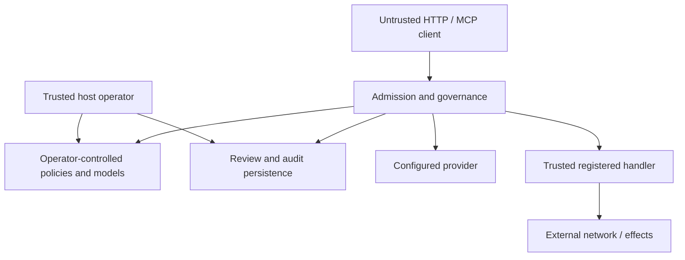

# Threat model

Gatekeeper mediates AI requests and registered tools. Protected assets are credential/capability integrity, tenant isolation, policy/model integrity, private prompt/output data, authorized effects and durable audit records. [SECURITY.md](SECURITY.md) defines the current controls and their implementation limits.

## Trust boundaries

Prompts, model responses, arguments and session identifiers are untrusted. Operators control keys, tenants, policies, artifacts, providers and handlers. INTERNAL principals hold deliberate elevated trust. A compromised host, malicious operator or malicious registered Python handler is outside application containment.

## Threats and residual risks

| Threat | Current control | Residual risk |
|---|---|---|
| Caller asserts privileged capability | Credential-derived principal; strict schemas | Stolen operator keys confer their real privilege |
| Cross-tenant reads/review | Tenant admission and ownership; explicit INTERNAL administration | Store/key reload must reach all serving processes |
| Injection, jailbreak or harmful content | Symbolic veto, detectors, fusion and optional judge | Probabilistic errors, distribution shift, degraded tiers |
| Permissive/unrelated cached verdict | HIGH-only scoped reuse and current symbolic checks | Expiry/eviction/flush remove state; model errors remain possible |
| Leaky output or judge outage | Secret/leak checks, PII processing, explicit SAFE acceptance | Incomplete regex/NER/substring coverage; optional grounding |
| Approval replay or changed action | Context binding, expiry, one-use tool consume | No prompt/provider continuation; uncertain effect after a crash |
| Tool escalation or SSRF | Capability/schema/policy, review, audit intent, pinned HTTP destination | Custom handlers are trusted; no general sandbox |
| Policy traversal/partial deployment | Validation, atomic replace, snapshot integrity | Live policy coordination is per process |
| Resource exhaustion | Body/schema/admission and worker/MCP queue limits | No universal synchronous/nested hard deadline; local budgets per process |
| Redis outage creates new local authority | Configured shared controls fail closed | Availability loss; backend tests do not certify application replicas |
| Audit failure/tampering | Intent before effect and explicit storage authority | Effects cannot be undone; host files mutable; multi-writer acceptance absent |
| Malicious provider/system prompt | Output guardrails, operator configuration | System prompts bypass user-prompt screening and must be trusted |
| Dependency/model substitution | Model pins/weight checks, strict replay, dependency/image CI | Runtime ranges are not a complete deployment lock |

## Assurance scope

Tests cover implementation contracts; frozen replay covers consistency under a declared offline profile. Neither establishes protection against every attack or production operation. No compliance certification, completed penetration-test claim or general performance SLO is made. TLS/ingress, secret management, network policy, backups, resource budgets and incident handling require deployment-specific controls.
